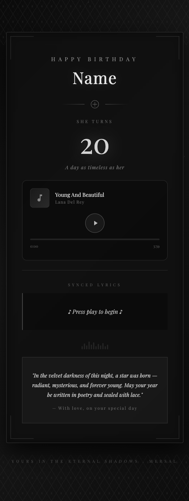
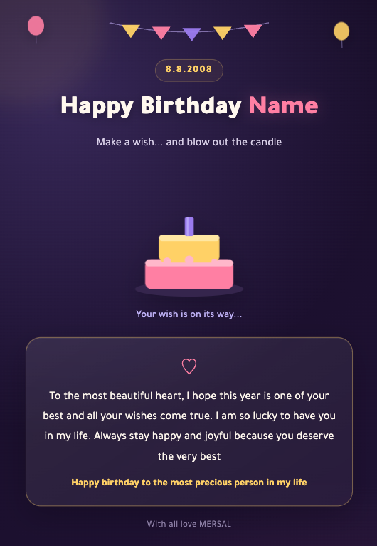
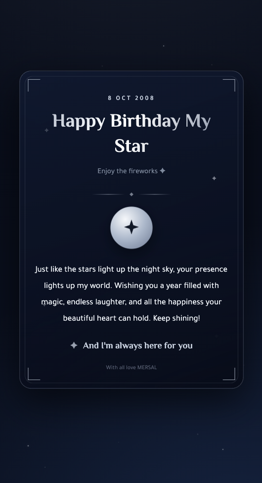
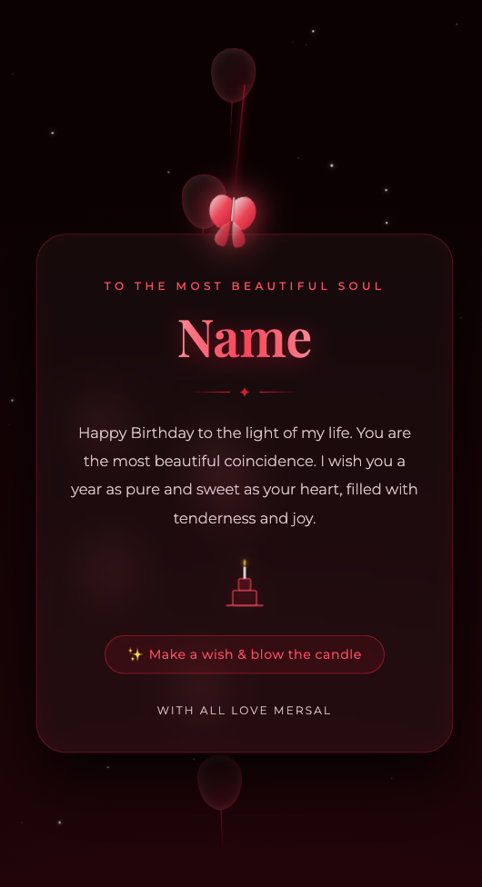
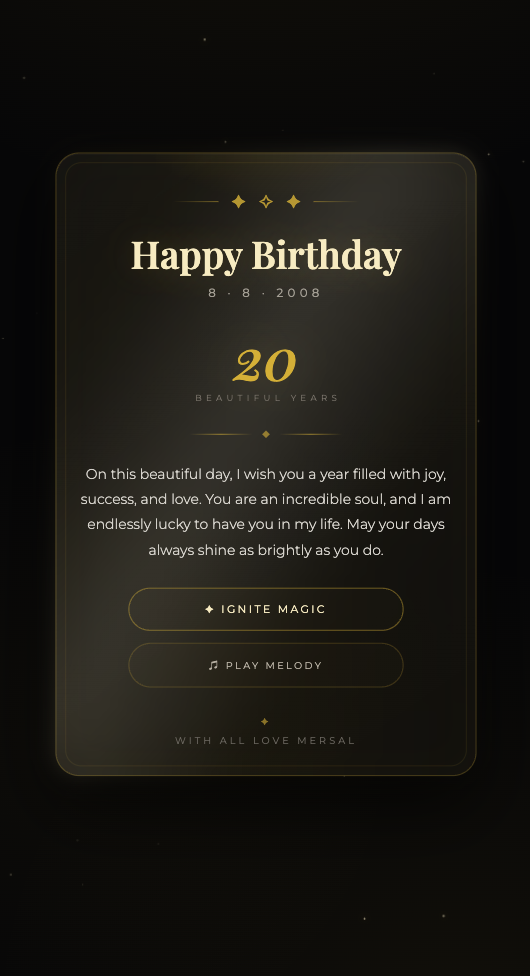

# Mersal | مِرسال

**Making every occasion a little more memorable.**

Mersal is a creative digital brand specializing in beautifully designed electronic greeting cards and personalized QR code experiences, bringing a modern and thoughtful touch to special occasions.

## About the Project

Mersal is an independently owned and developed project that combines creativity, design, and web development to deliver elegant, accessible, and interactive digital experiences.

## Features

- Digital greeting card collections
- Personalized QR code experiences
- Elegant and modern designs
- Responsive experiences across devices
- Arabic and English language support

## My Role

**Founder, Owner & Web Developer**

Responsible for the concept, branding, UI/UX design, front-end development, and ongoing improvement of Mersal.

## Greeting Card Collection

  
  
  
  
  

## Project Showcase

This repository serves as a public portfolio showcase of Mersal's designs and development.

The project is independently created and maintained by **GHYD-ops**.

## Copyright

© 2026 Mersal. All rights reserved.

All original designs, branding assets, and creative content are the property of Mersal. Unauthorized reproduction or commercial use is prohibited without permission.
